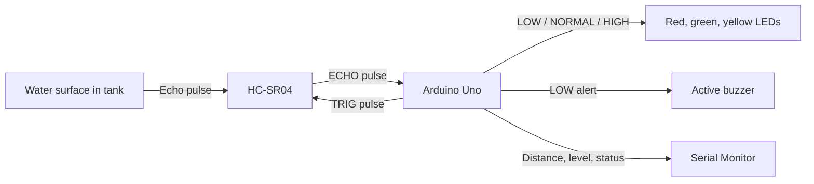

# Smart Water Monitoring System

A simple Arduino Uno prototype that estimates the water level in a tank using a non-contact HC-SR04 ultrasonic sensor. LEDs show whether the level is low, normal, or high, and an active buzzer alerts when the level is low.

> **Scope:** This project measures water level only. The HC-SR04 does not measure water purity or other water-quality properties.

## Problem statement

Checking a tank by sight can be inconvenient, especially when the tank is covered or difficult to reach. This prototype measures the distance from a sensor above the water to its surface, estimates the level, and provides a local visual and audible indication.

## Objectives

- Measure the distance from the HC-SR04 to the water surface.
- Estimate water level and percentage using the tank's measured dimensions.
- Report distance, level, percentage, and LOW/NORMAL/HIGH status over Serial.
- Use LEDs for status and sound an alert when the level is LOW.
- Safely reject missing or out-of-range sensor readings.

## Hardware components

- Arduino Uno and USB cable
- HC-SR04 ultrasonic sensor
- Red, yellow, and green LEDs
- Three 220–330 ohm current-limiting resistors (one per LED)
- 5 V active buzzer compatible with an Arduino output pin
- Breadboard and jumper wires
- A stable container or tank for testing

The HC-SR04 commonly operates at 5 V. Its ECHO pin outputs a 5 V signal: **do not connect ECHO directly to a 3.3 V-only GPIO** on boards such as ESP32; use an appropriate voltage divider or logic-level shifter. Keep the Arduino, breadboard, and connections away from water, and mount the sensor securely above the tank.

## Software and tools

- Arduino IDE
- Arduino Uno board support (included with the Arduino IDE)
- USB data cable and Serial Monitor
- No additional libraries are required

## Block diagram



## Circuit connections

| Component connection | Arduino Uno connection |
|---|---|
| HC-SR04 VCC | 5 V |
| HC-SR04 GND | GND |
| HC-SR04 TRIG | D9 |
| HC-SR04 ECHO | D10 |
| Red LED anode, through its own 220–330 Ω resistor | D2 |
| Red LED cathode | GND |
| Yellow LED anode, through its own 220–330 Ω resistor | D3 |
| Yellow LED cathode | GND |
| Green LED anode, through its own 220–330 Ω resistor | D4 |
| Green LED cathode | GND |
| Active buzzer positive (+) | D5 |
| Active buzzer negative (−) | GND |

The LEDs must each have a series resistor. This pin map must match the definitions at the top of [`water_monitoring.ino`](./water_monitoring.ino). See [docs/circuit-connections.md](./docs/circuit-connections.md) for additional wiring notes.

## Working principle

1. The Arduino sends a short pulse on TRIG.
2. The HC-SR04 emits ultrasound and raises ECHO for the time the sound takes to travel to the water and return.
3. The program converts that round-trip time into distance.
4. It subtracts the sensor's mounting offset and calculates the water level from the tank dimensions.
5. The Arduino selects an LED and buzzer state based on the configured percentage thresholds, then prints the reading.

The ultrasonic sensor detects a surface and its distance; it cannot tell whether water is safe, pure, acidic, or turbid.

## Water-level calculation

If the sensor's acoustic face is level with the tank rim:

```text
Water level = Tank height − Distance from the sensor to the water surface
Water level percentage = (Water level / Tank height) × 100
```

In the sketch, `tankHeightCm` is the internal vertical distance from the tank bottom to its rim. `sensorAboveTankCm` is the vertical distance from the tank rim up to the sensor face (zero when the face is level with the rim). The code accounts for an above-rim mounting position as follows:

```text
Distance from rim to water = Measured sensor-to-water distance − sensor-above-rim offset
Water level = Tank height − Distance from rim to water
```

The result is limited to the tank's physical range of 0 to `tankHeightCm`. If the sensor is mounted below the rim, if the reference point is somewhere else, or if the tank has an unusual shape, redefine the reference geometry and calculation accordingly. A non-vertical or irregular tank may need a measured volume-versus-height calibration table; a height percentage is not necessarily the same as a volume percentage.

## Setup and execution

1. Measure your tank and sensor mounting position as described in [docs/testing-and-calibration.md](./docs/testing-and-calibration.md).
2. Open `water_monitoring.ino` in the Arduino IDE.
3. Set `tankHeightCm`, `sensorAboveTankCm`, `lowThresholdPercent`, and `highThresholdPercent` near the top of the sketch. The `30.0 cm` height in the file is only an example, not a universal tank size.
4. Select **Arduino Uno** under **Tools > Board**, then select the correct USB port under **Tools > Port**.
5. Click **Verify** to compile, then **Upload** to program the board.
6. Open **Tools > Serial Monitor** and select **9600 baud**. Keep the sensor pointed vertically down at the water surface.

## Calibration

Measure the tank's *inside* height from the bottom to the rim. Measure the vertical gap from the tank rim to the sensor's acoustic face; enter that as `sensorAboveTankCm`. For a sensor face level with the rim, use `0.0`. Measure vertically, not along a sloped wall. Check the output with the tank empty and at a known water height. More detailed steps and limitations are in [docs/testing-and-calibration.md](./docs/testing-and-calibration.md).

Adjust the low and high thresholds as percentages of tank height. LOW includes values at or below `lowThresholdPercent`; HIGH includes values at or above `highThresholdPercent`; the range between them is NORMAL. The buzzer sounds only for LOW.

## Learning explanation

### Embedded systems and the microcontroller

An **embedded system** is a small computer built into a device to perform a particular job. Here, the Arduino, sensor, LEDs, and buzzer form the system. The **microcontroller** (the main chip on the Arduino Uno) reads input signals, runs the program, and controls output pins.

### How the ultrasonic sensor works

The Arduino briefly sets **TRIG** HIGH to ask the HC-SR04 to measure. The module sends an ultrasonic sound pulse. When the reflected sound returns, **ECHO** stays HIGH for the sound's round-trip travel time. The Arduino measures that HIGH duration. Dividing the time in microseconds by approximately 58 gives the distance in centimetres; the division accounts for sound travelling to the surface and back.

`pulseIn(echoPin, HIGH, echoTimeoutUs)` waits for ECHO to become HIGH, measures how long it stays HIGH, and returns that duration in microseconds. If no pulse arrives before the timeout, it returns zero. The sketch treats zero and distances outside the HC-SR04's approximate 2–400 cm range as invalid and turns off all indicators rather than showing a made-up level.

### How the program decides what to show

The program subtracts the sensor-above-rim offset from the measured distance, then subtracts the resulting rim-to-water distance from the tank height. It divides the level by tank height and multiplies by 100 to get a percentage.

The `if` / `else if` / `else` conditions compare this percentage with the configured thresholds:

- At or below the low threshold: red LED and buzzer on.
- At or above the high threshold: yellow LED on.
- Between the thresholds: green LED on.

Each status turns the other LEDs and the buzzer off. An invalid reading turns all indicators off. `Serial.print()` sends the measurement and status to the computer so they appear in the Serial Monitor.

### Sketch walkthrough

This walkthrough follows the sketch from top to bottom; comments in the source explain the important statements in place.

1. **Pin constants:** `trigPin`, `echoPin`, the three LED pins, and `buzzerPin` assign Arduino Uno digital pins to each connection. These values must agree with the wiring table.
2. **Tank settings:** `tankHeightCm` stores the measured internal height. `sensorAboveTankCm` stores the sensor face's height above the rim. The two threshold variables set the LOW and HIGH boundaries. The included dimensions and thresholds are adjustable examples.
3. **Timing and range constants:** `echoTimeoutUs` bounds how long the sketch waits for an echo; the distance limits reject values outside the sensor's approximate useful range; `measurementIntervalMs` sets a one-second interval between measurements.
4. **`WaterStatus`:** the enum gives the three possible valid classifications names: LOW, NORMAL, and HIGH.
5. **`measureDistanceCm()`:** first it drives TRIG LOW briefly, HIGH for 10 microseconds, then LOW. It calls `pulseIn()` to time ECHO. A zero timeout result or a distance outside the sensor range returns `-1.0` as an invalid-reading marker. A valid echo duration is divided by 58 to produce centimetres.
6. **`setIndicators(...)`:** this helper takes four true/false values and writes them to the red, yellow, green, and buzzer pins. `HIGH` turns a connected output on; `LOW` turns it off.
7. **`setup()`:** configures TRIG and indicator pins as outputs and ECHO as an input. It starts with all indicators off, opens Serial communication at 9600 baud, and prints a title and a reminder about the system's scope. Arduino runs `setup()` once after power-up or reset.
8. **Beginning of `loop()`:** Arduino repeats `loop()` continuously. It calls `measureDistanceCm()`. If that function reports an invalid reading, the program switches every indicator off, prints a diagnostic message, waits one interval, and returns from this pass without calculating a level.
9. **Level calculation:** for a valid echo, `distanceFromRimCm` removes the sensor-above-rim gap. `waterLevelCm` subtracts that distance from the tank height. The next conditional statements clamp the result to 0–tank height so the reported level cannot be negative or exceed 100%.
10. **Percentage and classification:** the division and multiplication produce a percentage. The first `if` selects LOW at or below its threshold and activates red plus the buzzer. `else if` selects HIGH at or above its threshold and lights yellow. The final `else` selects NORMAL and lights green. This order makes the boundaries explicit.
11. **Serial output:** the `Serial.print()` calls display measured distance, estimated level, percentage, and status, with units and one decimal place.
12. **Repeat interval:** `delay(measurementIntervalMs)` waits one second at the end of a valid pass. The loop then begins another measurement.

## Illustrative Serial Monitor output

The following values are examples only; actual output depends on your tank and sensor readings.

```text
Smart Water Monitoring System
This prototype measures water level, not water quality.
Distance to water: 25.0 cm | Water level: 5.0 cm (16.7%) | Status: LOW
Distance to water: 15.0 cm | Water level: 15.0 cm (50.0%) | Status: NORMAL
Distance to water: 4.0 cm | Water level: 26.0 cm (86.7%) | Status: HIGH
Invalid reading: check sensor wiring, alignment, and range.
```

## Testing procedure

1. With power disconnected, check the wiring, LED resistor placement, common ground, and secure sensor mounting.
2. Power the Uno over USB and open the Serial Monitor at 9600 baud.
3. Compare the reported distance against a ruler measurement from the sensor face to a flat water surface.
4. Test several known fill levels. Confirm the reported level and percentage change in the expected direction.
5. Test values below, between, and above your configured thresholds. Confirm LOW uses red and the buzzer, NORMAL uses green, and HIGH uses yellow.
6. Observe a missing or obstructed echo and confirm the program reports it as invalid with all indicators off.
7. Keep all electronics dry throughout testing. Do not claim physical testing until you have performed it on the assembled prototype.

## Limitations

- The system estimates level from a distance measurement; it is not a water-quality or water-safety instrument.
- HC-SR04 readings can be affected by splashing, foam, condensation, angled surfaces, obstacles, narrow tanks, and sensor dead zones.
- The sketch maps level linearly to percentage. That percentage describes height, not volume, for tanks whose cross-section changes with height.
- The sensor has a finite range (approximately 2–400 cm); choose a suitable installation and validate readings against physical measurements.
- An invalid reading turns indicators off; it does not distinguish a wiring fault from an out-of-range or obstructed echo.
- The active buzzer and LEDs are basic local indicators, not a certified alarm system.

## Future enhancements

- Add an LCD or OLED to display readings locally.
- Use an ESP32 and a suitable level-shifting arrangement for a wireless dashboard.
- Add a water-temperature sensor.
- Add pH or turbidity modules only with suitable calibration; those measure different properties and do not alone certify water safety.
- Add data logging and historical graphs.
- Consider pump control only with an appropriate driver, electrical isolation, dry-run/overflow protection, and other safety mechanisms. **Pump control is not implemented in this initial project.**

## Author

Add your name, institution, and project-review details here.
