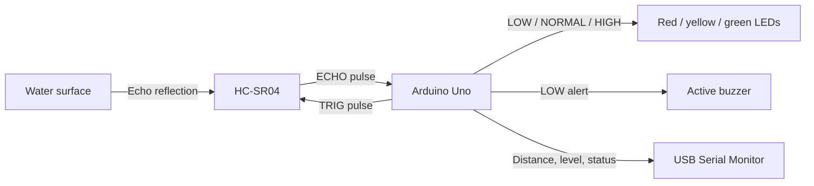

# Smart Water Monitoring System

A small Arduino Uno prototype that estimates the water level in a tank without touching the water. An HC-SR04 ultrasonic sensor measures the gap between its face and the water surface. Three LEDs show the level category, and an active buzzer warns when the level is low.

> **Scope:** This prototype monitors water **level**, not water quality. The ultrasonic sensor cannot measure purity, pH, turbidity, or temperature.

## Problem statement

It can be useful to know whether a tank is nearly empty, at a normal level, or nearly full without opening it or placing a sensor in the water. This project demonstrates a low-cost way to estimate that level and give a local visual and audible warning.

## Objectives

- Measure the distance from a sensor mounted above the water to the water surface.
- Convert that distance into an approximate water depth and percentage.
- Classify the result as **LOW**, **NORMAL**, or **HIGH** using adjustable thresholds.
- Show the category with LEDs and sound an alert only for LOW.
- Report readings in the Arduino Serial Monitor and reject invalid measurements safely.

## Hardware components

| Component | Purpose |
| --- | --- |
| Arduino Uno | Reads the sensor and controls the indicators |
| HC-SR04 ultrasonic sensor | Measures distance to the water surface |
| Red, yellow, and green LEDs | LOW, NORMAL, and HIGH status indicators |
| 3 × 220–330 ohm resistors | Limit LED current |
| Active buzzer rated for 5 V | Sounds during LOW status |
| Breadboard and jumper wires | Temporary circuit connections |
| Tank or container | Water-level test target |
| USB cable and computer | Programming and Serial Monitor |

The code expects a **5 V active buzzer** that can be driven by an Arduino output. Check the buzzer's current rating; use a transistor driver and a suitable supply if it exceeds the Uno pin's safe output current. A passive buzzer may need a tone-generating circuit or `tone()` instead.

## Software and tools

- Arduino IDE (or Arduino CLI)
- Arduino Uno board support package
- Serial Monitor set to **9600 baud**
- No third-party Arduino libraries are required

## Block diagram



## Circuit connections

| Part | Connection |
| --- | --- |
| HC-SR04 VCC | Arduino Uno 5V |
| HC-SR04 GND | Arduino Uno GND |
| HC-SR04 TRIG | Arduino digital pin 9 |
| HC-SR04 ECHO | Arduino digital pin 10 |
| Red LED anode (long leg) | Arduino digital pin 2 through a 220–330 ohm resistor |
| Red LED cathode (short leg) | GND |
| Yellow LED anode (long leg) | Arduino digital pin 3 through a 220–330 ohm resistor |
| Yellow LED cathode (short leg) | GND |
| Green LED anode (long leg) | Arduino digital pin 4 through a 220–330 ohm resistor |
| Green LED cathode (short leg) | GND |
| Active buzzer positive (+) | Arduino digital pin 5 (subject to the buzzer current-rating note above) |
| Active buzzer negative (-) | GND |

The HC-SR04 commonly operates at **5 V**. Its ECHO output is also a 5 V signal: do not connect it directly to a 3.3 V-only GPIO on a board such as an ESP32. Use an appropriate level shifter or resistor divider when adapting this circuit to a 3.3 V board.

Keep the Arduino, breadboard, wires, and buzzer away from water. Secure the sensor above the tank so it points vertically down at a reasonably flat part of the water surface. Do not let the sensor or electronics fall into the tank.

See [docs/circuit-connections.md](docs/circuit-connections.md) for the detailed wiring notes.

## Working principle

1. The Uno gives the HC-SR04 TRIG pin a brief HIGH pulse.
2. The sensor sends an ultrasonic sound burst. Its ECHO output stays HIGH for the time taken by the sound to travel to the water and back.
3. The Uno uses `pulseIn()` to time that HIGH pulse. The sketch converts the round-trip time to distance and divides by two.
4. The sketch subtracts the measured gap from the configured sensor-to-bottom distance to estimate water depth.
5. It computes a percentage, compares it with the LOW and HIGH thresholds, and updates the LEDs and buzzer.
6. It prints the distance, estimated depth, percentage, and status once per second.

### Water-level calculation

When the sensor face is at the tank's top reference:

**Water level = Tank height − Distance from the sensor to the water surface**

**Water level percentage = (Water level / Tank height) × 100**

In the sketch, `SENSOR_TO_BOTTOM_CM` is the sensor-face-to-bottom distance, and `TANK_WATER_DEPTH_CM` is the tank's usable inside water depth. If the sensor is mounted above the rim, `SENSOR_TO_BOTTOM_CM` includes the gap from the sensor face to the rim **plus** the inside depth. Subtracting the sensor-to-water distance then still gives water depth from the bottom. The percentage is divided by the usable inside depth, not by the above-rim gap.

For a tank with sloped sides or an irregular cross-section, this percentage is only a depth percentage; it is not necessarily the same as the fraction of the tank's volume. Measuring actual volume may require a tank-specific depth-to-volume calibration table.

## Setup and execution

1. Measure your tank and sensor mounting position; set the configuration values in [`water_monitoring.ino`](water_monitoring.ino) as explained in [docs/testing-and-calibration.md](docs/testing-and-calibration.md).
2. Wire the components with power disconnected, then inspect the connections and keep the electronics dry.
3. Open `water_monitoring.ino` in the Arduino IDE, select **Arduino Uno** and the correct port, then click **Verify** to compile.
4. Upload the sketch to the Uno.
5. Open **Tools → Serial Monitor** and select **9600 baud**.
6. Observe the displayed distance, water level, percentage, and status as the water level changes.

The sketch file is the complete Arduino program; there are no external libraries to install.

## Calibration

There is no universal tank height. Measure the actual usable inside depth and the vertical distance from the sensor face to the tank bottom. Enter these separately as `TANK_WATER_DEPTH_CM` and `SENSOR_TO_BOTTOM_CM`. If the sensor is directly over the tank's top reference, these values are usually equal. If it is above the rim, the sensor-to-bottom value is larger by the mounting gap.

Set `LOW_LEVEL_THRESHOLD_PERCENT` and `HIGH_LEVEL_THRESHOLD_PERCENT` to the percentages at which your project should indicate LOW and HIGH. LOW includes values equal to or below its threshold; HIGH includes values equal to or above its threshold. The two thresholds must be in ascending order and within 0–100%.

For best results, compare the reported distance against a ruler at several known water depths. Reposition the sensor if tank walls, braces, splashes, or a narrow tank cause unwanted echoes. More complete steps are in [docs/testing-and-calibration.md](docs/testing-and-calibration.md).

## Illustrative Serial Monitor output

The following values are examples only; they are **not** measurements from a physical test:

```text
Smart Water Monitoring System
Distance: 82.4 cm | Water level: 17.6 cm (17.6%) | Status: LOW
Distance: 50.1 cm | Water level: 49.9 cm (49.9%) | Status: NORMAL
Distance: 12.5 cm | Water level: 87.5 cm (87.5%) | Status: HIGH
Distance: INVALID - check sensor alignment and wiring.
```

## Testing procedure

- Compile for Arduino Uno and upload the sketch.
- With the tank empty, compare the displayed distance to the measured sensor-to-bottom distance. Confirm that the level is near zero.
- Add water in measured increments. Check that reported water depth increases as the distance decreases.
- Observe the LOW alert at or below its configured threshold, NORMAL between thresholds, and HIGH at or above its threshold.
- Confirm that the red LED and buzzer are on only for LOW, yellow only for NORMAL, and green only for HIGH.
- Briefly point the sensor away from a reflecting surface or disconnect it (with power handled safely) to check that a missing/invalid echo prints INVALID and turns indicators off.

These are suggested tests; no physical hardware test is claimed by this repository.

## Limitations

- The HC-SR04 estimates distance to a reflecting surface; it does not measure water quality.
- Its readings can be affected by ripples, foam, condensation, sensor alignment, narrow tanks, and nearby objects.
- Its useful measurement range is limited (commonly specified around 2–400 cm); very close or missing echoes are reported as invalid.
- The displayed percentage represents water depth, not necessarily volume for a non-rectangular tank.
- The buzzer output is intended for a suitable active buzzer; check its current rating.
- This is an educational prototype, not a certified safety or industrial monitoring device.

## Future enhancements

- Add an LCD or OLED to show readings without a computer.
- Use an ESP32 for a wireless dashboard; level-shift the HC-SR04 ECHO signal before a 3.3 V GPIO.
- Add a water-temperature sensor.
- Add pH or turbidity sensors with appropriate sensor-specific calibration and careful interpretation.
- Log readings and plot historical graphs.
- Add pump control only as a separate future design with an appropriate driver, electrical isolation, dry-run/overfill safeguards, and fail-safe behavior. Pump control is **not** implemented in this initial version.

## Learning guide

For simple-English explanations of embedded systems, the HC-SR04, `pulseIn()`, and the sketch statement by statement, see [docs/learning-guide.md](docs/learning-guide.md).

## Author

Add your name, course, institution, and project-review details here.

## Repository contents

- [`water_monitoring.ino`](water_monitoring.ino) — Arduino Uno sketch
- [`docs/circuit-connections.md`](docs/circuit-connections.md) — wiring and electrical notes
- [`docs/testing-and-calibration.md`](docs/testing-and-calibration.md) — setup, calibration, and test checklist
- [`docs/learning-guide.md`](docs/learning-guide.md) — beginner-friendly code walkthrough
- [`docs/images/README.md`](docs/images/README.md) — instructions for adding real project photos
